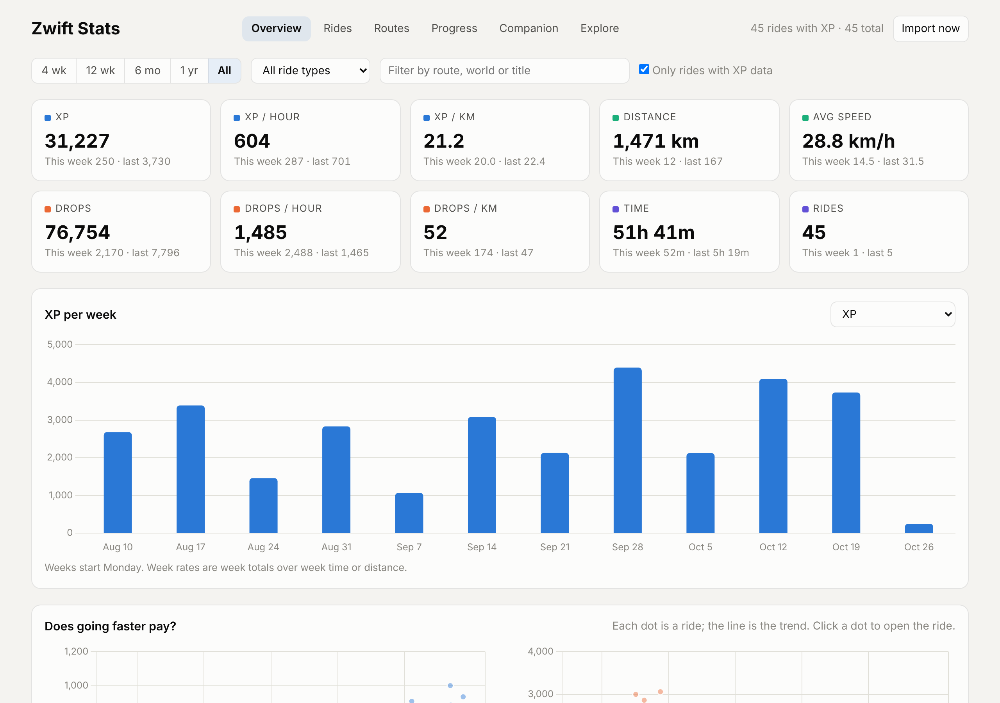
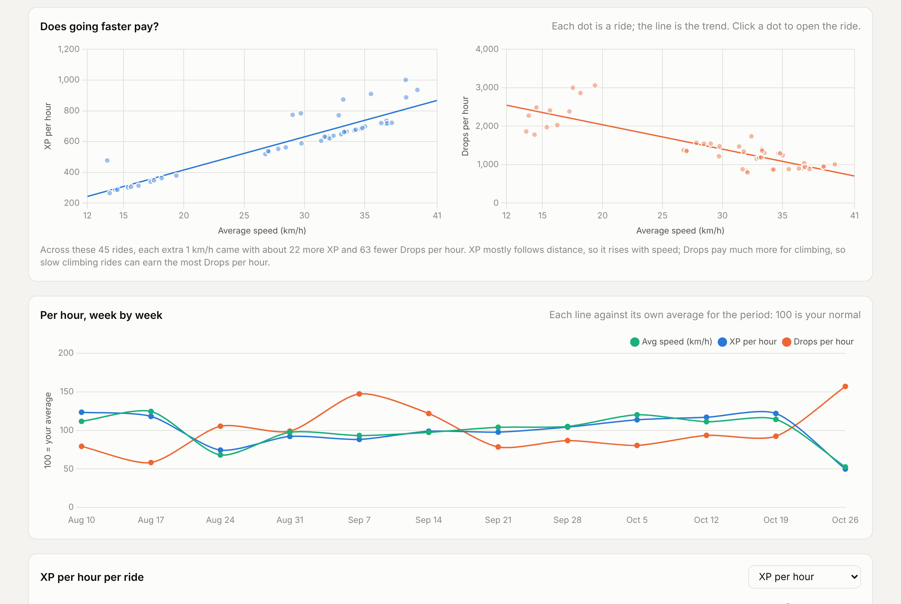
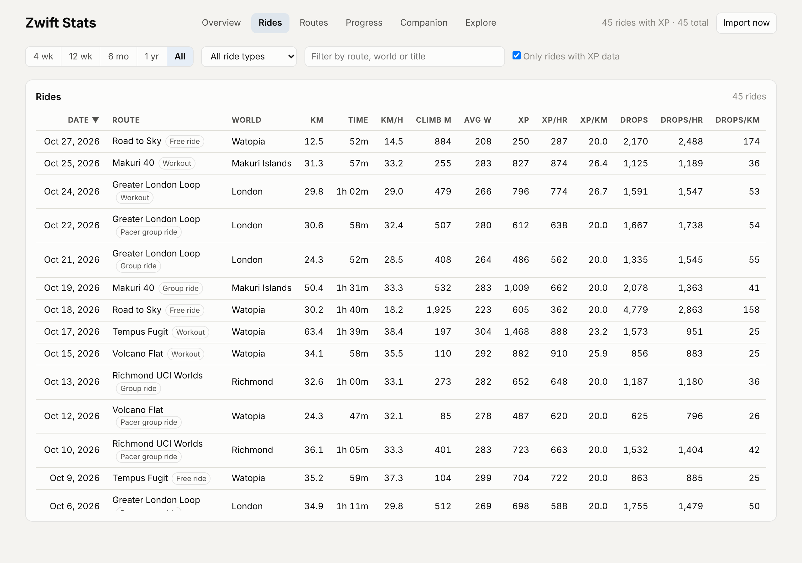

# Zwift Stats

A Mac app that shows how much XP and how many Drops every Zwift ride earned you: per ride, per week and per route, as totals and per km and per hour. It can also add those numbers to the ride's description on Strava.

Zwift doesn't put XP or Drops in its FIT files or its API, so Zwift Stats reads them from the log file Zwift writes on your Mac (`~/Documents/Zwift/Logs`). Everything stays on your computer in a local DuckDB database.







<sub>Screenshots use sample data.</sub>

## Install

1. Download **Zwift-Stats-macOS.zip** from the [latest release](https://github.com/blairj09/zwift-stats/releases/latest).
2. Unzip it and drag **Zwift Stats** into your Applications folder.
3. Open it. The app isn't notarized by Apple, so the first time macOS will refuse to open it. Go to **System Settings > Privacy & Security**, scroll down and click **Open Anyway**.
4. When asked, allow access to your Documents folder so the app can read `Documents/Zwift`.

Works on Apple silicon and Intel Macs running macOS 11 or later. Your past rides are imported on first launch, and new rides appear on their own while the app runs.

## What it does

- **Rides, weeks and routes:** XP, Drops, XP/km, XP/hr, Drops/km and Drops/hr for every ride the log recorded.
- **Progress:** your level and Drops balance over time, and where your XP came from.
- **Companion (optional):** sign in with your Zwift account to see your profile, followers, Ride Ons and upcoming events, and to estimate XP for rides recorded on other devices (phone, Apple TV). Only a refresh token is saved, never your password.
- **Strava (optional):** add a short XP and Drops note to each ride's Strava description, by hand or automatically.
- **Explore:** a read-only SQL console over your data.

See [zwift-hub/README.md](zwift-hub/README.md) for details, the command line, and the tables.

## Build from source

You need [Rust](https://rustup.rs) 1.90 or newer.

```bash
git clone https://github.com/blairj09/zwift-stats.git
cd zwift-stats/zwift-hub
./macos/build-app.sh      # builds and installs ~/Applications/Zwift Stats.app
```

`cargo run --release -- serve --open` runs the same explorer in your browser instead.
